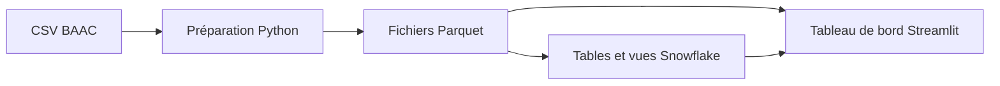

# HexaRoute — Analyse des accidents corporels de la route en France

**HexaRoute** est un tableau de bord interactif qui explore les données ouvertes BAAC sur les accidents corporels de la circulation en France. Il permet d’étudier leur évolution dans le temps, leur gravité, leur répartition géographique et les caractéristiques des usagers impliqués.

**[Ouvrir la démonstration HexaRoute sur Streamlit](https://hexaroute-france-baac-d9dv4klugsq9l2cbuedx4w.streamlit.app/)**

Le projet couvre la préparation des données en **Python**, leur stockage en **Parquet**, leur chargement dans **Snowflake** et leur visualisation dans **Streamlit**. La cartographie interactive utilise **Leaflet**.

## Fonctionnalités

| Onglet | Contenu |
| --- | --- |
| **Synthèse** | Nombre d’accidents corporels et mortels, de personnes tuées, de blessés hospitalisés et de véhicules impliqués. |
| **Tendances** | Évolution mensuelle, répartition par gravité et analyse par jour et par heure. |
| **Carte & territoires** | Carte interactive des accidents géolocalisés et comparaison des volumes par département. |
| **Usagers** | Exploration des données relatives aux personnes impliquées dans les accidents. |
| **Qualité** | Informations sur la couverture et la qualité des données. |
| **Sources & exports** | Présentation des sources et accès aux exports de l’application. |

Les indicateurs et les visualisations s’actualisent selon les filtres sélectionnés : **année**, **département**, **milieu** et **gravité**.

## Données et architecture

Les données proviennent des **Bulletins d’analyse des accidents corporels de la circulation (BAAC)**. Pour chaque année demandée, le pipeline récupère quatre fichiers : **Caractéristiques**, **Lieux**, **Véhicules** et **Usagers**. Un manifeste conserve leurs empreintes SHA-256 pour assurer la traçabilité des fichiers téléchargés.



| Source d’analyse | Usage |
| --- | --- |
| **Parquet local** | Lance le tableau de bord sans compte Snowflake. |
| **Snowflake** | Permet d’exploiter les données chargées dans l’entrepôt et de consulter les vues en SQL. |

Les fonds de carte nécessitent une connexion Internet.

## Démarrage local — Windows et PowerShell

Dans VS Code, ouvre le dossier qui contient `app.py` et `requirements.txt`, puis ouvre un terminal PowerShell.

### 1. Créer l’environnement et installer les dépendances

```powershell
py -3.12 -m venv .venv
.\.venv\Scripts\python.exe -m pip install -r requirements.txt
```

### 2. Télécharger et préparer les données 2025

```powershell
.\.venv\Scripts\python.exe .\scripts\download_data.py --years 2025
.\.venv\Scripts\python.exe .\scripts\build_dataset.py --years 2025
```

Le pipeline génère `data/processed/accidents.parquet` et `data/processed/usagers.parquet`. Si ces deux fichiers sont déjà présents et correspondent à l’année souhaitée, passe directement au lancement.

### 3. Lancer l’application

```powershell
.\.venv\Scripts\python.exe -m streamlit run app.py
```

Ouvre l’adresse affichée dans le terminal, généralement [http://localhost:8501](http://localhost:8501), puis sélectionne **Parquet local** dans **Source des analyses**.

## Utilisation avec Snowflake

Snowflake est facultatif. Pour utiliser ce mode, installe les dépendances supplémentaires et crée un fichier `.env` local s’il n’existe pas déjà :

```powershell
.\.venv\Scripts\python.exe -m pip install -r requirements-snowflake.txt
if (-not (Test-Path .env)) { Copy-Item .env.example .env }
```

Renseigne les paramètres de connexion dans `.env`. Seul le modèle `.env.example` est destiné au dépôt GitHub.

| Script SQL | Rôle |
| --- | --- |
| [`snowflake_01_schema.sql`](sql/snowflake_01_schema.sql) | Crée la base `HEXAROUTE_DB`, le schéma `ANALYTICS` et les tables `ACCIDENTS` et `USAGERS`. |
| [`snowflake_02_views.sql`](sql/snowflake_02_views.sql) | Crée les vues d’indicateurs nationaux, mensuels et départementaux. |
| [`snowflake_03_checks.sql`](sql/snowflake_03_checks.sql) | Vérifie les données après leur chargement. |

Le chargement du **millésime 2025** dans Snowflake a produit les volumes suivants :

| Table | Lignes chargées |
| --- | ---: |
| `ACCIDENTS` | 55 093 |
| `USAGERS` | 126 376 |

Pour consulter les indicateurs nationaux depuis une feuille SQL Snowflake :

```sql
SELECT *
FROM HEXAROUTE_DB.ANALYTICS.KPI_NATIONAUX
LIMIT 20;
```

## Déploiement

Le point d’entrée sur **Streamlit Community Cloud** est `app.py`. Les dépendances principales sont déclarées dans `requirements.txt`.

- **Mode Parquet :** rendre les fichiers préparés accessibles dans `data/processed/`.
- **Mode Snowflake :** installer les dépendances supplémentaires et configurer les paramètres de connexion dans le gestionnaire de secrets de l’hébergement.

Après le déploiement, vérifier le chargement des données, les filtres, les indicateurs, la carte et les exports.

## Périmètre et limites

- Le BAAC couvre les **accidents corporels recensés**. Les accidents uniquement matériels sont hors périmètre.
- Le **nombre d’accidents mortels** et le **nombre de personnes tuées** sont deux indicateurs distincts : un même accident peut causer plusieurs décès.
- Les graphiques présentent des **volumes observés**. Sans données de trafic ou de kilomètres parcourus, ils ne permettent pas de comparer le risque entre territoires, horaires ou conditions météorologiques.
- La carte utilise les coordonnées exploitables et peut afficher un échantillon. Le nombre de points visibles peut donc être inférieur au nombre d’accidents sélectionnés.
- Les analyses sont descriptives et ne constituent pas des prévisions.

## Auteur

**MAMPOUYA CLARK Chancy Loïc Franlly**  
Master 2 SISE — Université Lumière Lyon 2
