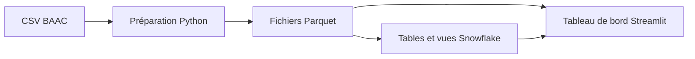

# HexaRoute — Analyse des accidents corporels de la route en France

**HexaRoute** est un tableau de bord interactif qui explore les données ouvertes BAAC sur les accidents corporels de la circulation en France. Il permet d’étudier leur évolution dans le temps, leur gravité et leur répartition géographique, ainsi que les caractéristiques des usagers impliqués.

Le projet couvre la préparation des données en **Python**, leur stockage en **Parquet**, leur chargement dans **Snowflake** et leur visualisation dans **Streamlit**. La cartographie interactive utilise **Leaflet**.

## Fonctionnalités

| Onglet | Contenu |
| --- | --- |
| **Synthèse** | Nombre d’accidents corporels et mortels, de personnes tuées, de blessés hospitalisés et de véhicules impliqués. |
| **Tendances** | Évolution mensuelle, répartition par gravité et analyse du nombre d’accidents par jour et par heure. |
| **Carte & territoires** | Carte interactive des accidents géolocalisés et comparaison des volumes par département. |
| **Usagers** | Exploration des données relatives aux personnes impliquées dans les accidents. |
| **Qualité** | Informations sur la couverture et la qualité des données. |
| **Sources & exports** | Présentation des sources et accès aux exports de l’application. |

Les filtres permettent de sélectionner le **millésime**, le **département**, le **milieu** et la **gravité**. Les indicateurs et les visualisations s’actualisent selon le périmètre choisi.

## Données et architecture

Les données proviennent des **Bulletins d’analyse des accidents corporels de la circulation (BAAC)**. Pour chaque millésime demandé, le pipeline récupère quatre fichiers : **Caractéristiques**, **Lieux**, **Véhicules** et **Usagers**. Un manifeste conserve les empreintes SHA-256 des fichiers téléchargés pour en assurer la traçabilité.



| Source d’analyse | Usage |
| --- | --- |
| **Parquet local** | Mode recommandé pour découvrir l’application sans compte Snowflake. |
| **Snowflake** | Source facultative pour exploiter les données chargées dans l’entrepôt et consulter les vues directement en SQL. |

Les fonds de carte nécessitent une connexion Internet.

## Démarrage local — Windows et PowerShell

Dans VS Code, ouvrir le dossier qui contient `app.py` et `requirements.txt`, puis ouvrir un terminal PowerShell.

### 1. Créer l’environnement Python et installer les dépendances

```powershell
py -3.12 -m venv .venv
.\.venv\Scripts\python.exe -m pip install -r requirements.txt
```

### 2. Télécharger et préparer les données 2025

```powershell
.\.venv\Scripts\python.exe .\scripts\download_data.py --years 2025
.\.venv\Scripts\python.exe .\scripts\build_dataset.py --years 2025
```

Le pipeline génère `data/processed/accidents.parquet` et `data/processed/usagers.parquet`. Si ces deux fichiers sont déjà présents et correspondent au millésime souhaité, passer directement au lancement.

### 3. Lancer l’application

```powershell
.\.venv\Scripts\python.exe -m streamlit run app.py
```

Ouvrir l’adresse affichée dans le terminal, généralement [http://localhost:8501](http://localhost:8501), puis sélectionner **Parquet local** dans **Source des analyses**.

## Utilisation avec Snowflake

Pour activer le mode Snowflake, installer les dépendances supplémentaires et créer un fichier `.env` local à partir du modèle fourni :

```powershell
.\.venv\Scripts\python.exe -m pip install -r requirements-snowflake.txt
Copy-Item .env.example .env
```

Ignorer la commande `Copy-Item` si le fichier `.env` existe déjà. Renseigner les paramètres de connexion dans `.env` et conserver ce fichier hors du dépôt Git.

| Script SQL | Rôle |
| --- | --- |
| [`snowflake_01_schema.sql`](sql/snowflake_01_schema.sql) | Crée la base `HEXAROUTE_DB`, le schéma `ANALYTICS` et les tables `ACCIDENTS` et `USAGERS`. |
| [`snowflake_02_views.sql`](sql/snowflake_02_views.sql) | Crée les vues d’indicateurs nationaux, mensuels et départementaux. |
| [`snowflake_03_checks.sql`](sql/snowflake_03_checks.sql) | Vérifie les données après leur chargement. |

Le chargement du **millésime 2025** dans Snowflake a produit les volumes suivants :

| Table | Lignes chargées |
| --- | ---: |
| `ACCIDENTS` | 55 093 |
| `USAGERS` | 126 376 |

Pour consulter les indicateurs nationaux depuis une feuille SQL Snowflake :

```sql
SELECT *
FROM HEXAROUTE_DB.ANALYTICS.KPI_NATIONAUX
LIMIT 20;
```

## Déploiement

Le point d’entrée Streamlit est `app.py`. L’environnement d’hébergement doit disposer de Python, des dépendances du projet et d’une source de données accessible.

- **Mode Parquet :** préparer les fichiers en amont et les rendre accessibles dans `data/processed/`.
- **Mode Snowflake :** installer les dépendances supplémentaires et configurer les paramètres de connexion dans le gestionnaire de secrets de l’hébergement.

Avant de partager une instance hébergée, vérifier le chargement des données, les filtres, les indicateurs, la carte et les exports.

## Périmètre et limites

- Les données BAAC couvrent les **accidents corporels recensés**. Elles excluent les accidents uniquement matériels.
- Le **nombre d’accidents mortels** est distinct du **nombre de personnes tuées** : un même accident peut causer plusieurs décès.
- Les indicateurs présentent des **volumes observés**. Sans données d’exposition, comme le trafic ou les kilomètres parcourus, ils ne permettent pas de comparer le risque d’accident entre territoires, horaires ou conditions météorologiques.
- La carte utilise les coordonnées exploitables et peut afficher un échantillon. Le nombre de points visibles peut donc être inférieur au nombre d’accidents sélectionnés.
- Les analyses sont descriptives et ne constituent pas des prévisions.

## Auteur

**MAMPOUYA CLARK Chancy Loïc Franlly**  
Master 2 SISE — Université Lumière Lyon 2
