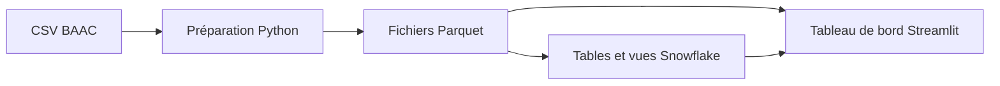

# HexaRoute — Observatoire des accidents corporels de la route

**HexaRoute** est un tableau de bord interactif qui permet d’explorer les accidents corporels de la circulation en France à partir des données ouvertes BAAC. Il présente leur évolution dans le temps, leur répartition géographique, leur gravité et les données relatives aux usagers impliqués.

Le projet couvre la préparation des données en **Python**, leur stockage en **Parquet**, leur chargement dans **Snowflake** et leur restitution dans **Streamlit**. La cartographie interactive est réalisée avec **Leaflet**.

## Aperçu de l’application


Les captures de l’application présentent le millésime **2025** en mode **Parquet local**. Les requêtes exécutées dans Snowflake sont illustrées plus bas.

## Fonctionnalités

| Onglet | Contenu |
| --- | --- |
| **Synthèse** | Nombre d’accidents corporels et mortels, de personnes tuées, de blessés hospitalisés et de véhicules impliqués. |
| **Tendances** | Évolution mensuelle, répartition par gravité et analyse par jour et par heure. |
| **Carte & territoires** | Carte interactive des accidents géolocalisés et comparaison des volumes par département. |
| **Usagers** | Exploration des données relatives aux personnes impliquées dans les accidents. |
| **Qualité** | Informations sur la couverture et la qualité des données. |
| **Sources & exports** | Présentation des sources et accès aux exports proposés par l’application. |

Les filtres permettent de choisir le **millésime**, le **département**, le **milieu** et la **gravité**. Les indicateurs et les visualisations s’actualisent selon la sélection.

### Quand les accidents sont-ils recensés ?


### Quels départements comptent le plus d’accidents dans la sélection ?


## Données et architecture

Le projet utilise les données **BAAC** (*Bulletins d’analyse des accidents corporels de la circulation*). Pour chaque millésime sélectionné, le pipeline récupère les fichiers **Caractéristiques**, **Lieux**, **Véhicules** et **Usagers**. Il enregistre leurs empreintes SHA-256 dans un manifeste pour assurer la traçabilité des fichiers téléchargés.



| Source | Usage |
| --- | --- |
| **Parquet local** | Mode recommandé pour lancer le tableau de bord sans compte Snowflake. |
| **Snowflake** | Source facultative pour analyser les données chargées dans l’entrepôt ou consulter les vues directement en SQL. |

Les fonds de la carte Leaflet nécessitent une connexion Internet.

## Démarrage local — Windows et PowerShell

Ouvrir dans VS Code le dossier qui contient `app.py`, puis exécuter les commandes suivantes dans PowerShell.

### 1. Installer les dépendances

```powershell
py -3.12 -m venv .venv
.\.venv\Scripts\python.exe -m pip install -r requirements.txt
```

### 2. Télécharger et préparer le millésime 2025

```powershell
.\.venv\Scripts\python.exe .\scripts\download_data.py --years 2025
.\.venv\Scripts\python.exe .\scripts\build_dataset.py --years 2025
```

Le pipeline génère `data/processed/accidents.parquet` et `data/processed/usagers.parquet`. Si ces fichiers sont déjà disponibles pour le millésime souhaité, passer directement au lancement.

### 3. Lancer le tableau de bord

```powershell
.\.venv\Scripts\python.exe -m streamlit run app.py
```

Ouvrir l’adresse affichée dans le terminal, généralement [http://localhost:8501](http://localhost:8501), puis sélectionner **Parquet local** comme source des analyses.

## Utilisation avec Snowflake

Pour utiliser Snowflake, installer les dépendances de `requirements-snowflake.txt` et créer un fichier `.env` local à partir de `.env.example`. Renseigner les paramètres de connexion du compte et du warehouse. Garder le fichier `.env` et les identifiants hors du dépôt.

| Script | Rôle |
| --- | --- |
| [`snowflake_01_schema.sql`](sql/snowflake_01_schema.sql) | Crée la base `HEXAROUTE_DB`, le schéma `ANALYTICS` et les tables `ACCIDENTS` et `USAGERS`. |
| [`snowflake_02_views.sql`](sql/snowflake_02_views.sql) | Crée les vues d’analyse des indicateurs nationaux, mensuels et départementaux. |
| [`snowflake_03_checks.sql`](sql/snowflake_03_checks.sql) | Exécute les contrôles après le chargement. |

Le chargement du **millésime 2025** a donné les volumes suivants :

| Table | Lignes chargées |
| --- | ---: |
| `ACCIDENTS` | 55 093 |
| `USAGERS` | 126 376 |

### Exemples de requêtes exécutées

**Indicateurs mensuels — accidents et personnes tuées**


**Analyse départementale — volumes d’accidents**


Pour consulter les indicateurs nationaux dans une feuille SQL Snowflake :

```sql
SELECT *
FROM HEXAROUTE_DB.ANALYTICS.KPI_NATIONAUX
LIMIT 20;
```

## Déploiement

Le point d’entrée de l’application est `app.py`. L’environnement d’hébergement doit disposer de Python, des dépendances de `requirements.txt` et d’une source de données accessible.

- **Parquet** : préparer les fichiers en amont et les rendre accessibles à l’application dans `data/processed/`.
- **Snowflake** : installer également les dépendances Snowflake et configurer les paramètres de connexion dans le gestionnaire de secrets de l’hébergement.

Avant de partager une instance hébergée, vérifier le chargement des données, les filtres, les indicateurs, la carte et les exports.

## Périmètre et limites d’interprétation

- Le BAAC couvre les **accidents corporels recensés**. Les accidents uniquement matériels ne font pas partie de ce périmètre.
- Le **nombre d’accidents mortels** et le **nombre de personnes tuées** sont deux indicateurs différents : un accident peut faire plusieurs victimes.
- Les résultats décrivent des **volumes observés**. Sans données d’exposition, comme le trafic ou les kilomètres parcourus, ils ne permettent pas de comparer le risque entre territoires, horaires ou conditions météorologiques.
- La carte s’appuie sur les coordonnées exploitables et peut afficher un échantillon. Le nombre de points visibles peut donc être inférieur au nombre total d’accidents sélectionnés.
- Les analyses sont descriptives et ne constituent pas des prévisions.

## Auteur

**MAMPOUYA CLARK Chancy Loïc Franlly**  
Master 2 SISE — Université Lumière Lyon 2